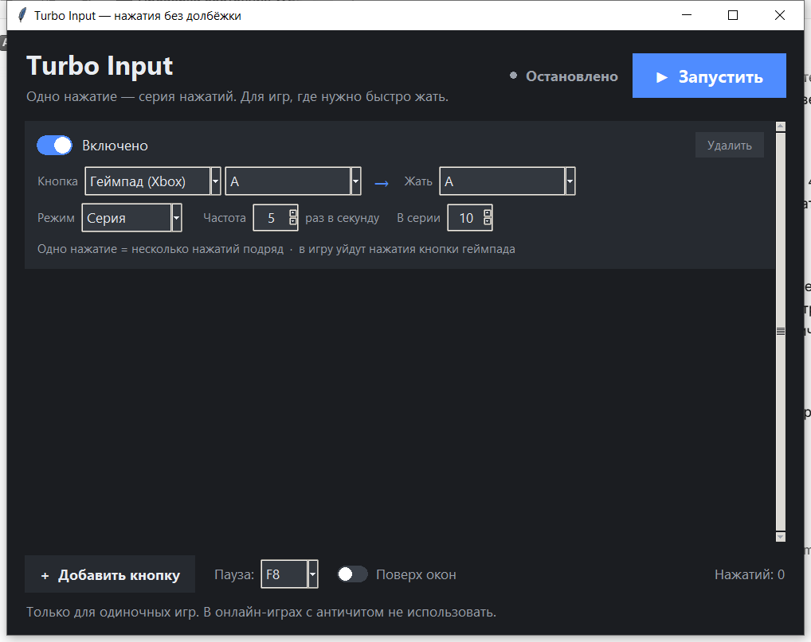

# Turbo Input

Одно нажатие — серия нажатий. Приложение для Windows: снимает с пальцев
необходимость быстро долбить кнопку (QTE, комбо, «нажми A несколько раз»).



## Скачать

⬇️ **[TurboInput_Setup.exe — установщик](https://github.com/Tenshin22/turbo-input/releases/latest)** — на вкладке Releases всегда лежит последняя версия (там же и портативный `TurboInput.exe` без установки).

При первом запуске Windows может показать синее окно SmartScreen («Windows защитила ваш компьютер») — это потому, что у приложения нет цифровой подписи. Нажми **«Подробнее» → «Выполнить в любом случае»**.

Работает на уровне Windows: клавиши отправляются через `SendInput` со скан-кодом,
кнопки геймпада — через виртуальный Xbox-контроллер (ViGEmBus). Сторонние
драйверы для клавиатуры не нужны.

> **Только для одиночных игр.** В онлайн-играх с античитом (EAC, BattlEye,
> Vanguard) такой ввод считается нарушением правил — это бан.

---

## Быстрый старт

1. Запусти **`TurboInput.exe`** (двойной клик). Консоль не нужна.
2. По умолчанию: **кнопка A на геймпаде → кнопка A, 12 раз в секунду**
   (игра получает нажатия настоящего геймпада).
3. Нажми **«Запустить»** и сверни окно. В игре держи A — пойдёт серия нажатий.
4. **F8** — пауза/продолжить, не выходя из игры. **«Остановить»** — полностью
   выключить.

Настройки сохраняются автоматически: рядом с `.exe`, если папка доступна
для записи (портативный режим), иначе — в `%APPDATA%\TurboInput\config.json`
(так бывает при установке через `TurboInput_Setup.exe` в Program Files).

## Что нужно для вывода на геймпад

Клавиатурный вывод работает сразу. Чтобы приложение могло нажимать **кнопки
геймпада**, нужен виртуальный геймпад — драйвер **ViGEmBus** (бесплатный,
Microsoft-подписанный, ставится один раз):

1. Скачай `ViGEmBus_1.22.0_x64_x86_arm64.exe`:
   <https://github.com/nefarius/ViGEmBus/releases/latest>
2. Запусти установщик, согласись с UAC, дождись окончания.
3. Готово — перезагрузка обычно не нужна. `ViGEmClient.dll` уже лежит рядом
   с приложением (и внутри `.exe`).

Если драйвера нет, приложение честно скажет об этом внизу окна после запуска.
Игры при этом видят обычный Xbox 360-контроллер — никаких настроек в игре не нужно.

## Интерфейс

| Элемент | Что делает |
|---|---|
| Переключатель «Включено» | включает/выключает конкретную кнопку |
| «Кнопка: Геймпад (Xbox) / Клавиатура» | чем нажимать |
| — если «Геймпад» | список: `A`, `B`, `X`, `Y`, `LB`, `RB`, `LT`, `RT`, `Start`, `Back`, `LS`, `RS`, D-Pad |
| — если «Клавиатура» | список: `A`…`Z`, `0`…`9`, `F1`…`F12`, Пробел, Enter, стрелки и т. д. |
| «Жать» | что отправлять в игру: **того же типа**, что выбран слева — кнопка геймпада или клавиша |
| «Режим: Удержание» | пока держишь кнопку — нажатия идут с выбранной частотой |
| «Режим: Серия» | одно короткое нажатие = N нажатий подряд |
| «Частота» | 1–30 нажатий в секунду (12–15 обычно достаточно) |
| «В серии» | сколько нажатий в серии (для режима «Серия») |
| «Добавить кнопку» | добавить ещё одну пару кнопка → кнопка |
| «Поверх окон» | окно остаётся видимым поверх игры |
| «Пауза: F8» | глобальная клавиша паузы |

Примеры:

- `Геймпад: A` → `Жать: A` — турбо для игры, которая слушает только геймпад.
- `Клавиатура: F9` → `Жать: E` — турбо для игры, которая слушает клавиатуру.

## Если игра не реагирует

1. **Игра запущена от администратора** — запусти `TurboInput.exe` тоже от
   администратора (правый клик → «Запуск от имени администратора»).
2. **Для вывода на геймпад не стоит ViGEmBus** — установи драйвер (см. выше).
3. **Слишком быстро/медленно** — поставь 8–10 нажатий в секунду и увеличь `press_ms` до 25–30
   в `config.json`.
4. **Ничего не происходит** — проверь счётчик «Нажатий»: если растёт, значит
   скрипт жмёт, а игра игнорирует эту кнопку (попробуй другую).

## Вариант без приложения: Steam Input

Для игр в Steam можно обойтись встроенным турбо:

1. Steam → Настройки → Контроллер → поддержка Xbox-контроллера.
2. Библиотека → игра → «Управление контроллером» → раскладка.
3. Кнопка → «Дополнительные настройки» → **Turbo** (повтор при удержании).

## Консольная версия

```bat
python turbo.py config.json
```

`Ctrl+C` — выход. Для отладки без отправки нажатий: `python turbo.py --dry-run`.

## Сборка из исходников

Нужен Python 3.10+ (у тебя 3.13).

```bat
build.bat
```

Скрипт поставит PyInstaller и соберёт `TurboInput.exe` (внутрь попадёт
`ViGEmClient.dll`).

Или запуск без сборки:

```bat
python app.py
```

## Файлы

| Файл | Назначение |
|---|---|
| `TurboInput.exe` | готовое приложение (внутри — `ViGEmClient.dll`) |
| `ViGEmClient.dll` | клиент виртуального геймпада (нужен при запуске из исходников) |
| `app.py` | графический интерфейс |
| `engine.py` | движок: XInput, SendInput, ViGEmBus, биндинги |
| `turbo.py` | консольная версия |
| `config.json` | настройки (общие для app и CLI) |
| `run.bat` | запуск консольной версии |
| `build.bat` | сборка `.exe` |
| `selftest.py` | автотест: серия на клавиатуру и на геймпад |

## Ограничения

- Только Windows.
- Один активный геймпад (первый в XInput).
- Ввод не проходит в окна, запущенные от администратора, если приложение — нет.
- Античиты ядрового уровня блокируют такой ввод — и это правильно, не обходи.
